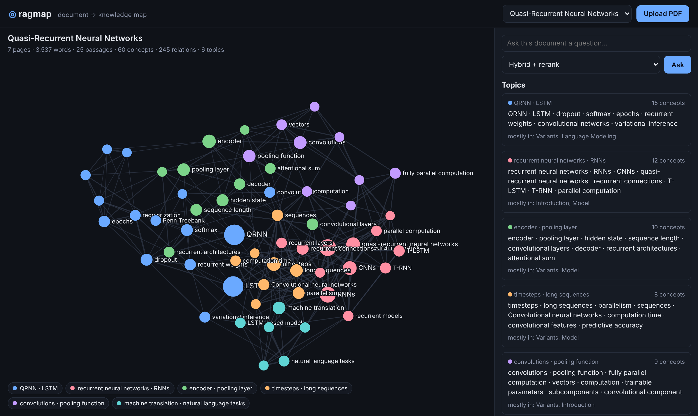
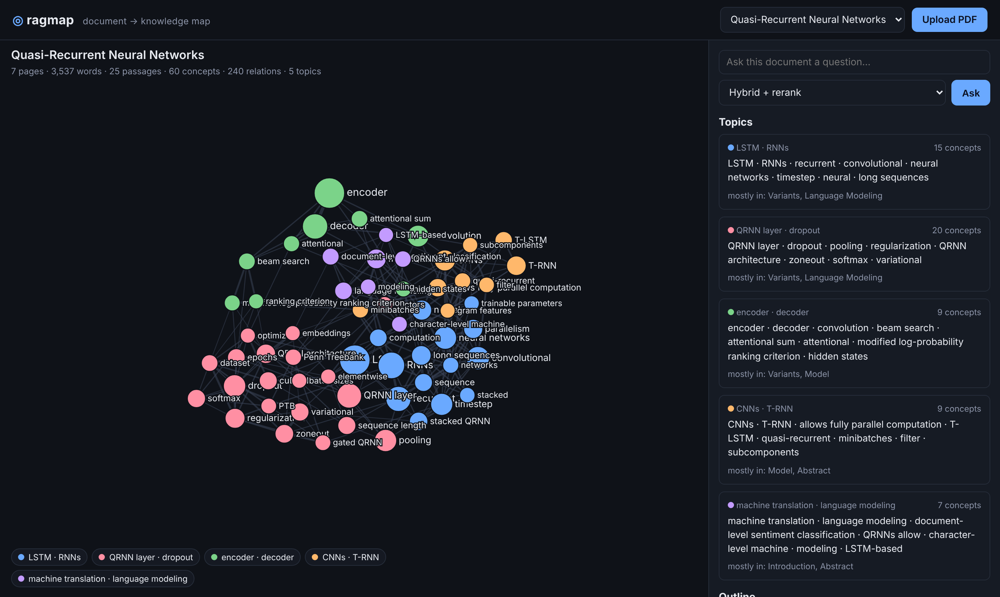
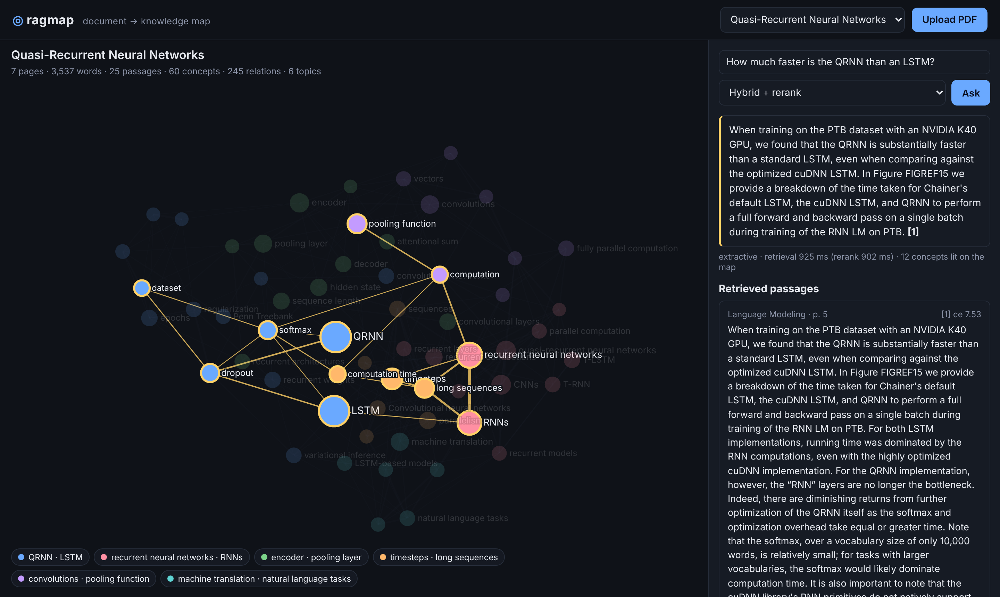
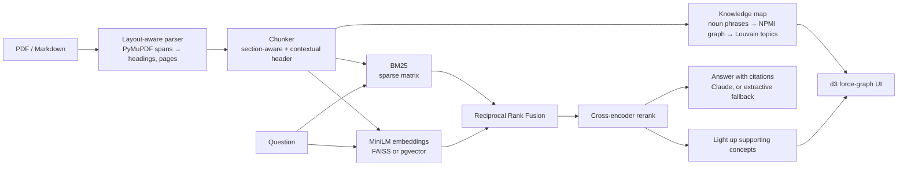

# ragmap: turn any PDF into an interactive knowledge map you can question

[](https://github.com/juhidixit/rag-knowledge-map/actions/workflows/ci.yml)


ragmap is a retrieval-augmented generation (RAG) engine with a visual front end. Upload a PDF and it:

1. **parses the layout**: it recovers headings, sections and page numbers, and drops running headers and footers;
2. **indexes it for hybrid search**: BM25 and dense embeddings (FAISS, or Postgres + pgvector), merged with Reciprocal Rank Fusion and reranked by a cross-encoder;
3. **draws a knowledge map**: the key concepts in the document, how they co-occur, and the topic clusters they form. Every node links back to the exact passages and pages it came from;
4. **answers questions with citations**, and lights up the part of the map that supports each answer.

Every retrieval design choice was **measured on a public benchmark**: 888 questions over 281 full-text arXiv papers (QASPER). The tables below are the measured results, including the configurations where an idea did not help.



| Click a concept: related concepts and source passages | Ask a question: the supporting concepts light up |
|---|---|
|  |  |

---

## Why this is more than "chat with a PDF"

* **It is visual.** A knowledge map shows what a 30-page paper is about in a few seconds, before you know what to ask. Clicking a node gives the evidence behind it, highlighted, with its page number.
* **Retrieval and the map are connected.** When you ask a question, the concepts in the retrieved passages are highlighted on the map. You can see which part of the document an answer comes from, and which parts it ignored.
* **Every choice is measured.** `eval/` scores 4 chunking strategies × 4 retrievers on QASPER's annotator-marked evidence paragraphs. It also sweeps rerank depth against latency, so the defaults are based on data.
* **It is production-shaped.** It ships with a FastAPI service, a pluggable vector store (FAISS in-process or pgvector), Docker, CI with a real Postgres service container, and graceful fallbacks: no API key means extractive answers, and no spaCy model means regex phrase extraction.

## Quickstart

```bash
git clone https://github.com/juhidixit/rag-knowledge-map && cd rag-knowledge-map
python -m venv .venv && source .venv/bin/activate
pip install -e ".[models,nlp]"            # add ,llm for Claude-written answers, ,pgvector for Postgres
python -m spacy download en_core_web_sm

ragmap serve --preload ./library            # open http://127.0.0.1:8000 and upload a PDF
```

Or with Docker (models are baked into the image):

```bash
docker compose up --build                   # drop PDFs into ./library to index them at startup
```

Optional: `export ANTHROPIC_API_KEY=...` turns on grounded answers from Claude, with `[n]` citations to the retrieved passages. Without a key, the app returns the best extractive passage instead.

The CLI works without the web app:

```bash
ragmap ask paper.pdf "What dataset do they evaluate on?"
ragmap map paper.pdf > map.json
```

## Architecture



| Module | What it does |
|---|---|
| `ingest.py` | Reads PyMuPDF spans. The body font size is the most common span size, and larger or bold short lines become section headings. Repeated top and bottom lines (running headers, page numbers) are removed. Fixes NFKC ligatures and hyphenation. |
| `chunking.py` | `fixed` (sliding window), `paragraph`, and `section`, which packs whole paragraphs within one section. `section` can optionally prepend `Title > Section` to the **indexed** text only. Every chunk keeps word offsets, so evaluation is exact. |
| `retrieval.py` | BM25 as one sparse mat-vec, FAISS `IndexFlatIP` with ID-selector filtering, a `PgVectorStore` (HNSW, cosine) with the same interface, RRF fusion, and the cross-encoder reranker. |
| `engine.py` | Orchestrates the four modes `bm25 / dense / hybrid / hybrid_rerank`, with per-stage timings. |
| `knowledge_map.py` | Extracts spaCy noun-chunk candidates and scores them by tf-idf over the document's own passages × a word-frequency specificity prior × KeyBERT-style similarity to the document centroid. It then prunes redundant sub-phrases, builds NPMI-weighted co-occurrence edges, and finds Louvain topics. |
| `api.py` + `static/` | FastAPI endpoints and a dependency-free front end (vanilla JS + vendored d3). |

## Benchmark: QASPER (arXiv papers), measured, not claimed

**Setup.** [QASPER](https://allenai.org/data/qasper) (Dasigi et al., NAACL 2021) has questions written by people who had only read a paper's title and abstract. Other annotators then marked the paragraphs in the full text that answer each question. I used the dev split: **281 papers and 888 answerable questions** that have at least one text evidence paragraph. Questions whose evidence is only a figure or table were excluded.

A retrieved chunk counts as relevant if it covers at least 50% of an evidence paragraph (or at least 100 of its words). This keeps fixed windows, which cut paragraphs, comparable with structure-aware chunks. Two scopes are reported:

* **in-doc**: search only inside the question's paper (the chat-with-a-PDF use case);
* **corpus**: search all 281 papers at once (a research-library use case, and much harder).

Models: `sentence-transformers/all-MiniLM-L6-v2` (embeddings) and `cross-encoder/ms-marco-MiniLM-L-6-v2` (reranker). Both are small, CPU-friendly and off the shelf, with no fine-tuning. Reproduce with:

```bash
curl -O https://qasper-dataset.s3.us-west-2.amazonaws.com/qasper-train-dev-v0.3.tgz && tar xzf qasper-train-dev-v0.3.tgz
python eval/run_eval.py --qasper qasper-dev-v0.3.json --out results/
python eval/report.py results/qasper_results.json     # writes results/RESULTS.md
```

<!-- RESULTS -->

## API

| Method | Path | Body / params | Returns |
|---|---|---|---|
| `POST` | `/api/documents` | multipart `file` (PDF, .md, .txt) | the document's knowledge map |
| `GET` | `/api/documents` | | indexed documents with stats |
| `GET` | `/api/documents/{id}/map` | | `{nodes, links, topics, outline, stats}` |
| `GET` | `/api/documents/{id}/chunks?ids=a,b` | | passages with section, page and offsets |
| `POST` | `/api/search` | `{query, k, mode, doc_ids, answer}` | ranked hits, per-stage timings, supporting concepts, optional cited answer |
| `GET` | `/api/health` | | status and index sizes |

Configuration is through environment variables: `RAGMAP_EMBED_MODEL`, `RAGMAP_RERANK_MODEL`, `RAGMAP_VECTOR_STORE=faiss|pgvector`, `RAGMAP_PG_DSN`, `RAGMAP_LLM_MODEL`, `RAGMAP_PRELOAD`.

## Tests

```bash
pip install -e ".[dev,nlp]" && python -m spacy download en_core_web_sm
pytest -q        # 26 tests; the unit and API tests use a hashing embedder, so no model download is needed
```

CI runs ruff and pytest on Python 3.10 and 3.12. A second job runs the pgvector store against a real `pgvector/pgvector:pg16` service container and checks it against FAISS. The end-to-end tests build a real PDF in memory and check that headings and pages survive parsing.

## Limitations and next steps

* Scanned PDFs need OCR, which is not included yet. Tables and figures are skipped by the parser.
* The index lives in memory unless you use pgvector, and uploaded maps are not persisted between restarts.
* The reranker is a general web-search cross-encoder. A domain-tuned or larger reranker (for example `bge-reranker-base`) is the obvious next experiment, and the eval harness is set up to measure it.
* Concept extraction is unsupervised. It works well on technical prose, but generic phrases can still slip through on very short documents.

## Credits

QASPER: Dasigi, Lo, Beltagy, Cohan, Smith, Gardner. *A Dataset of Information-Seeking Questions and Answers Anchored in Research Papers*, NAACL 2021 (CC BY 4.0). The demo PDF is generated from the QASPER full text of *Quasi-Recurrent Neural Networks* (Bradbury et al., 2016) by `scripts/make_sample_pdf.py`. d3.js is vendored under the ISC license.

MIT © Juhi Dixit
